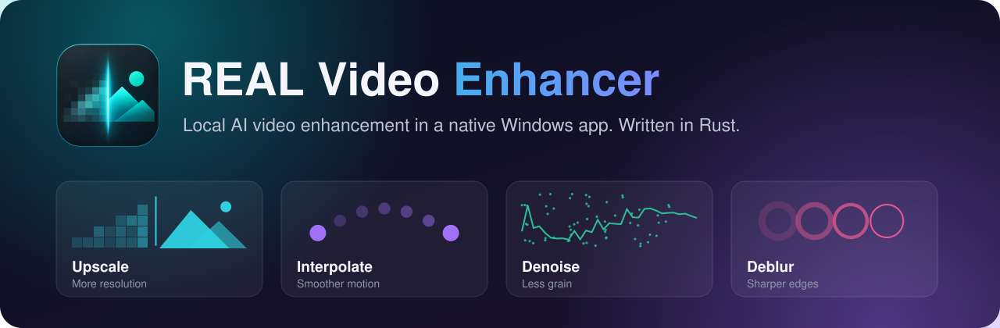
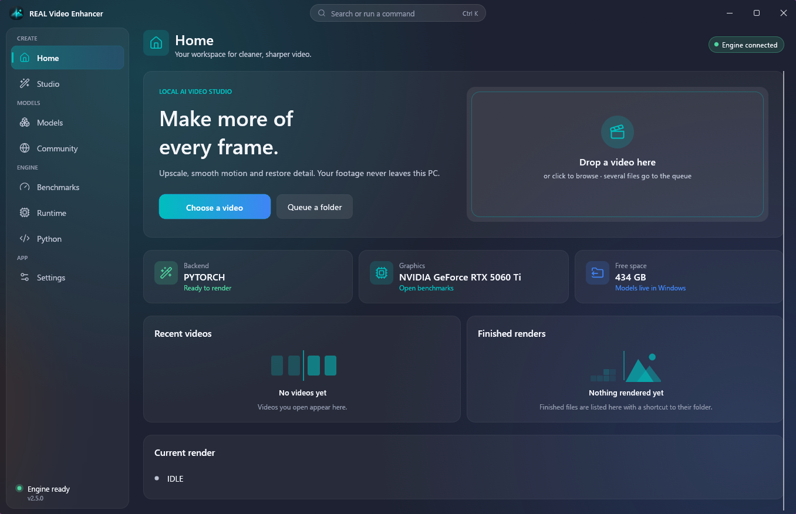
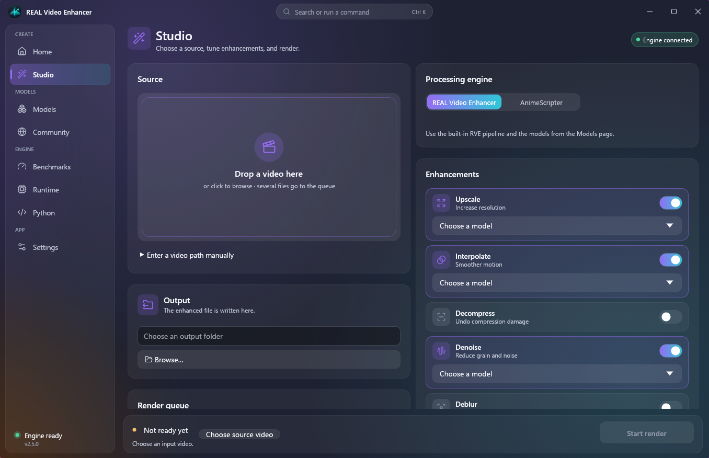
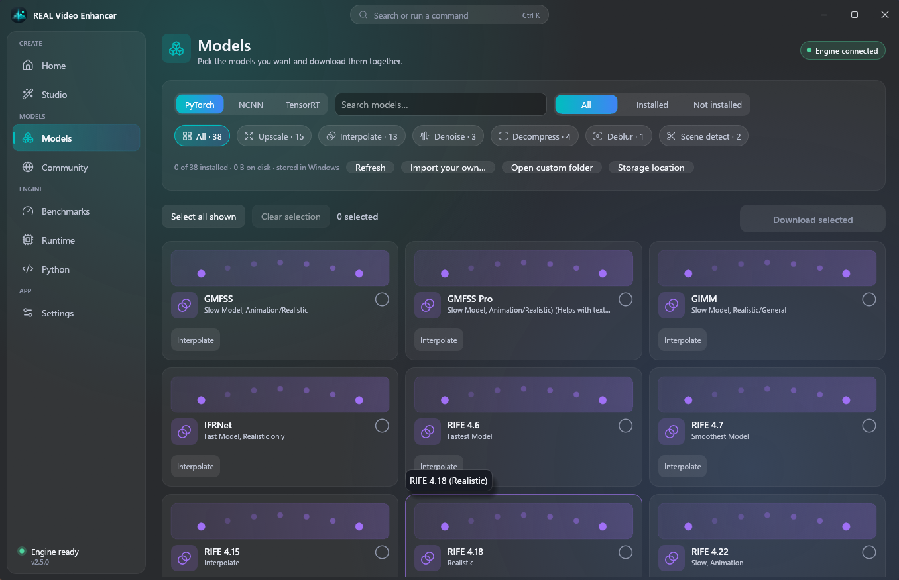
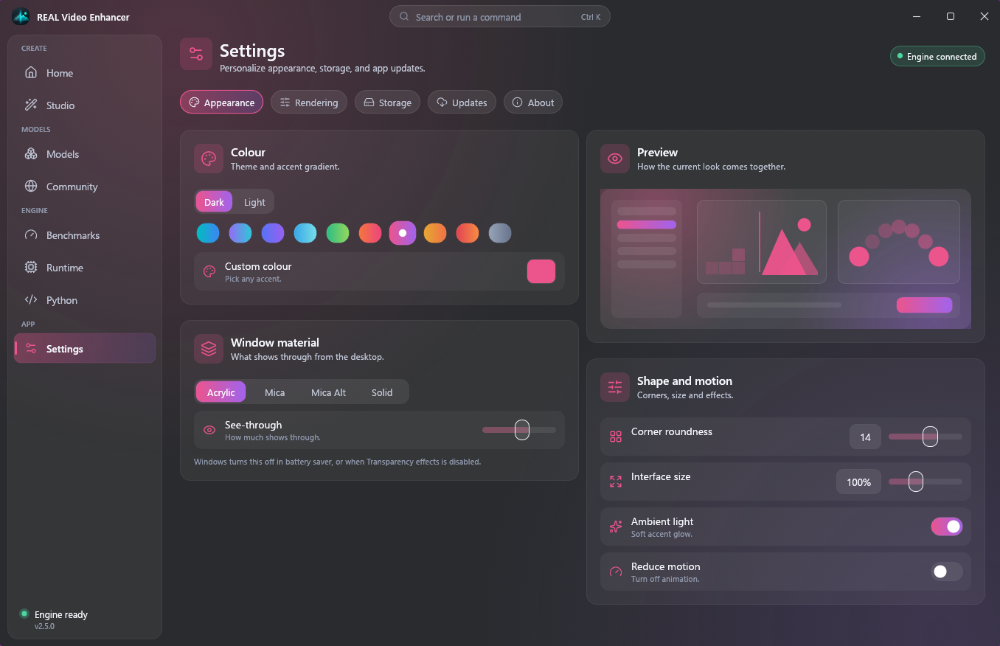
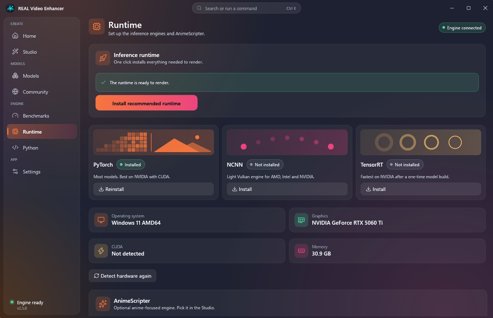
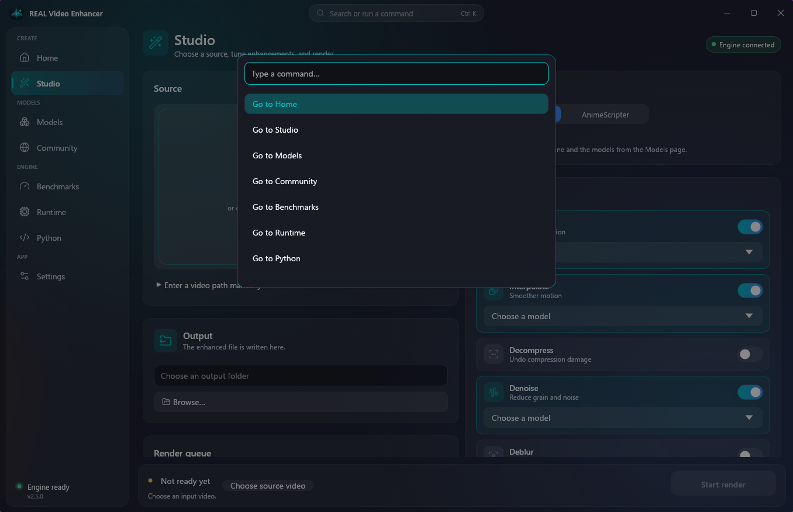
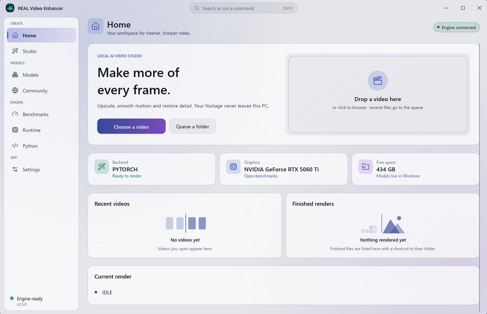
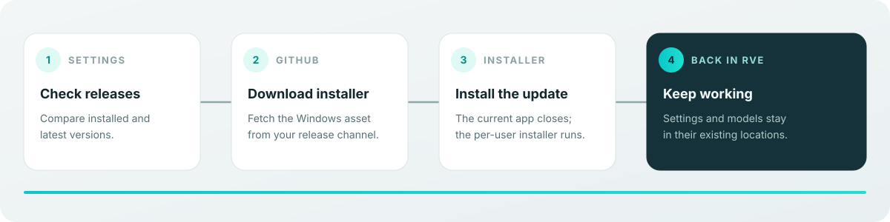
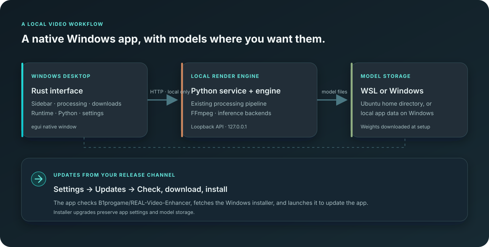

<div align="center">



<br />

[](https://github.com/B1progame/REAL-Video-Enhancer/releases/latest)


[](LICENSE)

**[Download the installer](https://github.com/B1progame/REAL-Video-Enhancer/releases/latest)** ·
[What's new](CHANGELOG.md) ·
[Roadmap](ROADMAP.md) ·
[Upstream project](https://github.com/TNTwise/REAL-Video-Enhancer)

<br />



</div>

Upscale, smooth motion and restore detail on your own PC. The interface is a **native Rust app** on real Windows acrylic; the video processing stays in the project's **Python engine**. Your footage never leaves the machine.

## A look around

<table>
  <tr>
    <td width="50%"></td>
    <td width="50%"></td>
  </tr>
  <tr>
    <td align="center"><b>Studio</b><br />Drop a video, switch on enhancements, render</td>
    <td align="center"><b>Models</b><br />Tick several and download them together</td>
  </tr>
  <tr>
    <td></td>
    <td></td>
  </tr>
  <tr>
    <td align="center"><b>Appearance</b><br />Make it yours, with a live preview</td>
    <td align="center"><b>Runtime</b><br />One click installs the inference engine</td>
  </tr>
  <tr>
    <td></td>
    <td></td>
  </tr>
  <tr>
    <td align="center"><b>Ctrl + K</b><br />Every page and action from the keyboard</td>
    <td align="center"><b>Light theme</b><br />Same glass, daytime colours</td>
  </tr>
</table>

## Highlights

| | |
| --- | --- |
| 🎞️ **Enhancements** | Upscale, interpolate, decompress, denoise, deblur and slow motion |
| 📚 **Render queue** | Add files or a whole folder; they render one after another |
| ⏱️ **Honest progress** | Elapsed time, ETA or download speed and a Cancel button on every page |
| 📦 **Model manager** | Filters, installed sizes, per-model delete and your own custom weights |
| 🌐 **Community models** | Browse OpenModelDB with example previews |
| 📊 **Benchmarks** | Measure your models on your GPU and see the fastest ones charted |
| 🎨 **Your look** | Acrylic, Mica or solid, ten accent gradients or any colour, roundness, size, motion |
| 💾 **Storage** | Usage chart, cache pruning, and **Slim runtime** to drop files only compilers need |

## Install

1. Download `REAL-Video-Enhancer-*-Windows-Installer.exe` from [Releases](https://github.com/B1progame/REAL-Video-Enhancer/releases/latest) (about 13 MB).
2. Run it. It installs the app and its local engine.
3. Open **Settings → Storage**, choose **WSL Ubuntu** or **This PC · Windows**, and apply.
4. Open **Runtime** and press **Install recommended runtime**.
5. Pick models on the **Models** page, or let a render download what it needs.

Model weights are not bundled. The PyTorch runtime is large (several GB). On an NVIDIA CUDA install, **Settings → Storage → Slim runtime** freed about 2.7 GB on a test PC by removing C++ headers and static libraries; reinstalling PyTorch brings them back.

For WSL details and manual model installation, see [WSL-UBUNTU.md](WSL-UBUNTU.md).

## Shortcuts

| Keys | Does |
| --- | --- |
| <kbd>Ctrl</kbd> + <kbd>K</kbd> | Command palette |
| <kbd>Ctrl</kbd> + <kbd>1</kbd>…<kbd>8</kbd> | Switch page |
| Drag and drop | Open a video; extra files join the queue |

## Updating

Open **Settings → Updates** and press **Check for updates**, then **Download and install**. The installer is verified against the checksum GitHub publishes, runs quietly, and reopens the app. Settings and models are kept.

Checking and downloading updates needs no sign-in. The optional **Private repository access** field is only for people running their own private fork.

Uninstalling asks whether to also remove the managed runtime, models and app data.

<p align="center">
  
</p>

## How it fits together

<p align="center">
  
</p>

A loopback-only Python service connects the Rust window to the render engine. The app does not open a browser for its interface.

| Folder | Contents |
| --- | --- |
| `native-ui/` | Rust desktop app (egui) |
| `backend/` | Local engine service and render pipeline |
| `src/` | Shared engine helpers and version |
| `docs/assets/` | Logo, banner, diagrams and screenshots |

## Build from source

You need Rust, Python 3.11 with the project's dependencies, the Visual Studio C++ build tools with a Windows SDK, and Inno Setup 7.

```powershell
.\build-inno-installer.bat
```

The installer lands in `release-stage-<version>\installer\`.

Tests:

```powershell
cargo test --manifest-path native-ui\Cargo.toml
```

```powershell
python -m pytest backend\tests\unit_tests\test_storage_and_models.py backend\tests\unit_tests\test_probe_cache.py
```

The other tests under `backend\tests` need a Python environment with PyTorch installed.

## Known limits

- Windows acrylic and Mica need Windows 11 22H2 or newer; older systems get a solid window. Windows also turns the effect off in battery saver or when Transparency effects is disabled.
- AnimeScripter support is optional and still unfinished.
- Runtime installs show the current step and elapsed time, without an ETA.

## Credits and license

A customised fork of [TNTwise/REAL-Video-Enhancer](https://github.com/TNTwise/REAL-Video-Enhancer). The Rust interface, Windows installer, WSL model setup and updater are maintained here. Licensed under the [GNU AGPL v3.0](LICENSE); third-party models and bundled components may have their own terms.
