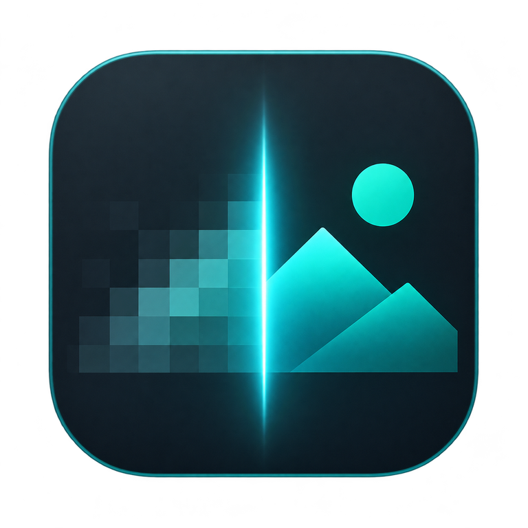

<div align="center">
  
  <h1>REAL Video Enhancer</h1>
  <p><strong>Restore and enhance video from a native Windows desktop app.</strong></p>
  <p>
    <a href="https://github.com/B1progame/REAL-Video-Enhancer/releases/latest">Download the Windows installer</a>
    ·
    <a href="https://github.com/B1progame/REAL-Video-Enhancer/releases">Release notes</a>
    ·
    <a href="https://github.com/TNTwise/REAL-Video-Enhancer">Original upstream project</a>
  </p>
</div>

REAL Video Enhancer is a Windows desktop application with a **native Rust interface** and the project's **Python video-processing engine**. It can keep model weights in WSL Ubuntu or on Windows, and it checks this fork's GitHub releases for app updates.

<p align="center">
  
</p>

## What you can do

- Open a video and choose interpolation, upscaling, restoration, denoising, and output options in the desktop app.
- Manage model downloads and runtime setup from the app's sidebar pages.
- Choose **WSL Ubuntu** or **Windows** for model storage. In WSL mode, the Windows app starts the selected distribution when needed.
- Choose a light or dark appearance, select an accent color, and adjust render defaults in Settings.
- Check for a newer release, download its Windows installer, and launch the installer from **Settings → Updates**.

The app does not bundle model weights. It downloads them during setup into the storage location you choose.

## Install

1. Download the latest `REAL-Video-Enhancer-*-Windows-Installer.exe` from [GitHub Releases](https://github.com/B1progame/REAL-Video-Enhancer/releases/latest).
2. Run the installer. It installs the Windows desktop app and its local Python engine.
3. Start the app and choose WSL Ubuntu or Windows for model storage.
4. Use **Settings → Model storage → Apply and install or verify all models** to prepare the selected location.

For WSL setup details and manual model installation, see [WSL-UBUNTU.md](WSL-UBUNTU.md).

## Updating from Settings

Open **Settings → Updates** and use **Check for updates**. If a newer Windows installer is available, select **Download update**, then **Install downloaded update**. The app downloads the installer from this repository's published GitHub release and starts it for you.

**Existing 2.4.29 installs need one manual update first.** That build checks the original upstream release feed, so it cannot discover releases published by this fork. Install 2.4.30 once from [GitHub Releases](https://github.com/B1progame/REAL-Video-Enhancer/releases/latest); later versions can update through Settings.

The installer updates the application files. It does not remove your model library or settings. When you uninstall, the uninstaller asks whether to also remove the managed runtime, downloaded models, and app data from Windows and WSL.

<p align="center">
  
</p>

## App pages

| Page | Purpose |
| --- | --- |
| **Home** | Runtime readiness, current render, and quick actions |
| **Process** | Select input and output paths and configure a render |
| **Downloads** | Browse the model catalog and manage downloads |
| **Runtime** | Install or repair the inference runtime |
| **Python** | Inspect the managed Python environment and its packages |
| **Settings** | Appearance, model storage, updates, and render defaults |

The Rust application is a Windows desktop program; it does not open a browser window for its interface. A loopback-only Python service connects the UI to the existing render engine.

## AnimeScripter status

The AnimeScripter integration code is preserved in the project, but it is **unfinished**. Its operations are not ready to rely on as part of the normal enhancement workflow.

## Build from source

On Windows, install Rust, Python 3.11 with the project's dependencies, Visual Studio C++ build tools with a Windows SDK, and Inno Setup 7. Then run from the repository directory:

```powershell
.\build-inno-installer.bat
```

The script builds the headless Python engine, compiles the optimized Rust desktop app, and creates the installer under `release-stage\installer\`.

## Project relationship

This is a customized fork of [TNTwise/REAL-Video-Enhancer](https://github.com/TNTwise/REAL-Video-Enhancer). The Rust desktop interface, Windows installer, WSL model setup, and updater are maintained in this repository; the video-processing engine remains Python.
